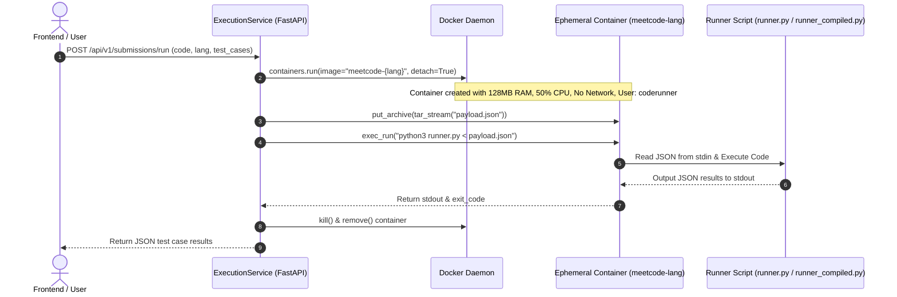

# 🔒 MeetCode - Sandboxed Code Execution Engine

This document details the architecture, security mechanics, containerized runners, and payload execution pipelines that power the **MeetCode Sandboxed Code Execution Engine**.

---

## 🏗️ Execution Architecture Overview

MeetCode allows users to write and execute code in **Python**, **C++**, and **Java**. Because user-submitted code can be untrusted or malicious (e.g., infinite loops, memory leaks, system file access), code is never executed directly on the host server. Instead, every code execution request runs inside a lightweight, ephemeral, heavily restricted Docker container.



---

## 1️⃣ Security & Container Restrictions (`execution_service.py`)

The `ExecutionService` (`backend/app/services/execution_service.py`) uses the Python `docker` SDK (`docker.from_env()`) to enforce strict isolation policies:

1. **Memory Limitation (`mem_limit="128m"`)**: Caps total RAM usage at 128 MB per container. Out-of-memory executions trigger automatic process termination.
2. **CPU Limit (`cpu_period=100000`, `cpu_quota=50000`)**: Restricts execution to **50% of a single CPU core**, preventing CPU exhaustion attacks.
3. **Network Disabling (`network_disabled=True`)**: Completely disables container network interfaces (`eth0`), preventing outbound HTTP/socket calls or data exfiltration attempts.
4. **Non-Root Execution User (`user="coderunner"`)**: Code executes under a limited non-root system account, preventing container privilege escalation or root system file modifications.
5. **Daemon Mode & Lifetime Cleanup**: Containers start with `tail -f /dev/null` in detached mode. After execution finishes, a `finally` block strictly calls `container.kill()` and `container.remove()`.

---

## 2️⃣ In-Memory Payload Injection (`_create_tar_stream`)

Instead of writing temporary files onto the host filesystem (which incurs I/O overhead and security risks), `ExecutionService` constructs an in-memory POSIX TAR archive in Python memory using `io.BytesIO` and `tarfile`:

```python
def _create_tar_stream(self, content: str, filename: str) -> io.BytesIO:
    tar_stream = io.BytesIO()
    data = content.encode('utf-8')
    with tarfile.open(fileobj=tar_stream, mode='w') as tar:
        tarinfo = tarfile.TarInfo(name=filename)
        tarinfo.size = len(data)
        tarinfo.mtime = time.time()
        tar.addfile(tarinfo, io.BytesIO(data))
    tar_stream.seek(0)
    return tar_stream
```
This tar stream containing `payload.json` (`{"code": "...", "test_cases": [...]}`) is injected directly into `/app` inside the container using `container.put_archive()`.

---

## 3️⃣ Language-Specific Execution Pipelines

### A. Python Execution (`backend/execution/runner.py`)
- **Container Image**: `meetcode-python` (`backend/execution/Dockerfile.python`)
- **Base OS**: `python:3.10-slim`
- **Execution Mechanism**:
  1. Reads `payload.json` from `sys.stdin`.
  2. Dynamically executes user-submitted code in a scoped dictionary scope using Python `exec(code, local_scope)`.
  3. Inspects `local_scope` for a `Solution` class or a `solve` function.
  4. Redirects `sys.stdout` to a `StringIO` buffer to isolate print outputs.
  5. Iterates through all test cases, evaluates arguments (`eval(f"dict({input_data})")`), invokes the target function, measures execution time with `time.time()`, and compares outputs against `expected_output`.
  6. Prints the final array of test case result objects as JSON to `stdout`.

### B. Compiled Languages: C++ & Java (`backend/execution/runner_compiled.py`)
- **Container Images**:
  - `meetcode-cpp` (`backend/execution/Dockerfile.cpp`) based on `gcc:latest` + `python3`.
  - `meetcode-java` (`backend/execution/Dockerfile.java`) based on `openjdk:17-slim` + `python3`.
- **Methodology**:
  Because C++ and Java are compiled languages, `runner_compiled.py` performs **code synthesis, compilation, execution, and output normalization**:

#### 1. Java Execution Pipeline (`solve_java`):
- Wraps user code in `Solution.java` if missing `class Solution`.
- Parses function argument names and data types (maps Python types to Java types: `int`, `boolean`, `double`, `String`, `int[]`, `String[]`).
- Synthesizes a test wrapper `Main.java` containing a custom recursive `__stringify(Object obj)` method to convert Java primitives, arrays, and objects into uniform string representations.
- Invokes `javac Solution.java Main.java`. If compilation fails, captures `stderr` and returns `{"error": "Compile Error", "details": ...}`.
- Runs `java Main`, parses formatted output markers (`__RESULT_idx__`), calculates execution times, and compares normalized strings against expected values.

#### 2. C++ Execution Pipeline (`solve_cpp`):
- Prepends standard competitive programming headers (`<vector>`, `<unordered_map>`, `<iostream>`, `<algorithm>`) and generic template printers (`__print_val(const T& val)`).
- Parses function parameters using regular expressions (`get_method_info`).
- Generates a synthesised `main.cpp` that instantiates `Solution sol;`, sets up test case variables, invokes the solution method, prints `__RESULT_idx__:`, and captures thrown C++ exceptions.
- Compiles using `g++ -O3 main.cpp -o solution` for maximum optimization.
- Executes `./solution`, extracts results via regex, normalizes whitespace and booleans (`True` -> `true`), and returns JSON results.

---

## 4️⃣ Language Dockerfile Specifications

### `backend/execution/Dockerfile.python`
```dockerfile
FROM python:3.10-slim
RUN useradd -m coderunner
WORKDIR /app
COPY runner.py /app/runner.py
RUN chown -R coderunner:coderunner /app
USER coderunner
CMD ["tail", "-f", "/dev/null"]
```

### `backend/execution/Dockerfile.cpp`
```dockerfile
FROM gcc:latest
RUN apt-get update && apt-get install -y python3 && rm -rf /var/lib/apt-get/lists/*
RUN useradd -m coderunner
WORKDIR /app
COPY runner_compiled.py /app/runner.py
RUN chown -R coderunner:coderunner /app
USER coderunner
CMD ["tail", "-f", "/dev/null"]
```

### `backend/execution/Dockerfile.java`
```dockerfile
FROM openjdk:17-slim
RUN apt-get update && apt-get install -y python3 && rm -rf /var/lib/apt-get/lists/*
RUN useradd -m coderunner
WORKDIR /app
COPY runner_compiled.py /app/runner.py
RUN chown -R coderunner:coderunner /app
USER coderunner
CMD ["tail", "-f", "/dev/null"]
```
