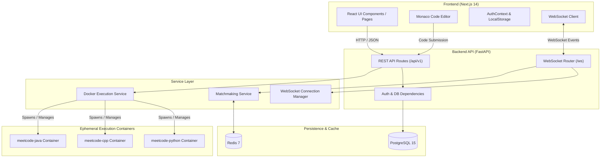

# 📘 MeetCode - Comprehensive Project Architecture & Working Guide

Welcome to the **MeetCode Technical Documentation Directory**. This folder contains an exhaustive, line-by-line, and component-by-component technical breakdown of every single file, module, protocol, and technology stack utilized in the **MeetCode** collaborative coding and interview platform.

---

## 📌 Master Document Index

| Document | Description | Key Modules Covered |
| :--- | :--- | :--- |
| 🏗️ **[Architecture & Tech Stack Summary](#-system-architecture-overview)** | High-level system design, data flows, and infrastructure | Docker, PostgreSQL, Redis, FastAPI, Next.js |
| ⚙️ **[Backend Explanation](./BACKEND_EXPLANATION.md)** | File-by-file breakdown of FastAPI endpoints, database ORM models, schemas, and utility scripts | `backend/app/*`, `backend/alembic/*`, database scripts |
| 💻 **[Frontend Explanation](./FRONTEND_EXPLANATION.md)** | File-by-file breakdown of Next.js 14 App Router, Monaco Editor integration, components, and state | `frontend/src/*`, `next.config.ts`, `AuthContext` |
| 🔒 **[Execution Engine](./EXECUTION_ENGINE.md)** | Deep dive into the Docker containerized code runner system | `execution_service.py`, `runner.py`, `runner_compiled.py`, Dockerfiles |
| ⚡ **[WebSockets & Matchmaking](./WEBSOCKETS_AND_MATCHMAKING.md)** | Complete walkthrough of Redis queues, WebSocket event loops, matchmaking algorithms, and forfeit logic | `websocket.py`, `websocket_manager.py`, `matchmaking_service.py` |

---

## 🛠️ Complete Tech Stack Overview

### 1. Frontend Technologies
- **Framework**: [Next.js 14 (App Router)](https://nextjs.org/) - React framework supporting server/client components, routing, and optimization.
- **Language**: TypeScript - Provides end-to-end type safety across components, context, and API calls.
- **Styling**: Tailwind CSS & Lucide Icons - Modern utility-first CSS framework with custom glassmorphic dark-theme aesthetics.
- **Code Editor**: `@monaco-editor/react` (VS Code Editor Engine) - Multi-language code editor with syntax highlighting, line numbers, and theme support.
- **State & HTTP**: React Context API (`AuthContext`), Axios HTTP client with request interceptors for JWT injection.
- **Interactivity**: `canvas-confetti` for victory animations, Native WebSocket API with automatic re-connection handling.

### 2. Backend Technologies
- **Framework**: [FastAPI](https://fastapi.tiangolo.com/) - High-performance Python web framework based on OpenAPI standards and Starlette.
- **Asynchronous ORM**: SQLAlchemy 2.0 (Async) + `asyncpg` driver for PostgreSQL.
- **Database Migrations**: Alembic - Schema migration tool for versioning database states.
- **Authentication**: PyJWT + Passlib (`bcrypt`) for password hashing and OAuth2 Bearer JWT token generation.
- **Validation**: Pydantic v2 + `pydantic-settings` for strongly typed config management and payload validation.

### 3. Execution & In-Memory Services
- **Code Execution Sandbox**: Docker Python SDK (`docker`) communicating with Docker Daemon to manage isolated execution containers (`meetcode-python`, `meetcode-cpp`, `meetcode-java`).
- **Caching & Real-Time Queue**: [Redis 7](https://redis.io/) (via `redis.asyncio`) for:
  - **Matchmaking Queues**: Redis Sorted Sets (`ZSET`) keyed by timestamp.
  - **Private Room Keys**: Redis String Key-Value pairs with 10-minute Time-To-Live (TTL).
  - **Pub/Sub Channeling**: Inter-process event signaling for scaled socket nodes.

---

## 📐 System Architecture Overview



---

## 📂 Project Directory Tree

```
MEETCODE/
├── backend/
│   ├── alembic/                 # Database migrations (env.py, version scripts)
│   ├── app/
│   │   ├── api/                 # FastAPI REST & WebSocket endpoints
│   │   ├── core/                # App config, logging setup, security parameters
│   │   ├── db/                  # SQLAlchemy session setup, base models
│   │   ├── models/              # Database ORM entity models (User, Question, Match, etc.)
│   │   ├── schemas/             # Pydantic data schemas for request/response validation
│   │   ├── services/            # Core business logic (Execution, Matchmaking, WebSocket Manager)
│   │   └── main.py              # Application entry point & router attachment
│   ├── execution/               # Code runner scripts & language Dockerfiles
│   ├── Dockerfile               # Backend production container configuration
│   ├── requirements.txt         # Python package dependencies
│   ├── seed_questions.py        # Database populator for initial coding questions
│   └── verify_invite.py         # Utility script for testing/verification
├── frontend/
│   ├── public/                  # Static assets and icons
│   ├── src/
│   │   ├── app/                 # Next.js App Router (pages: editor, matchmaking, practice, profile)
│   │   ├── components/          # Reusable UI elements (Navbar, LoginModal, TestCasesList, SubmissionsList)
│   │   ├── context/             # AuthContext state provider
│   │   ├── globals.css          # Tailwind CSS global styles & dark theme utilities
│   │   └── lib/                 # Axios client, logging utility, API endpoints
│   ├── Dockerfile               # Frontend production container configuration
│   ├── package.json             # Frontend Node.js dependencies
│   ├── tailwind.config.ts       # Tailwind theme & animation settings
│   └── tsconfig.json            # TypeScript compiler configuration
├── docker-compose.yml           # Complete system orchestrator (Frontend, Backend, DB, Redis)
├── docker-compose.backend-only.yml # Minimal dev orchestrator (Backend, DB, Redis)
└── working/                     # Comprehensive technical documentation folder (YOU ARE HERE)
```

---

## 🎯 Navigating the Detailed Documentation

Please navigate to the specific file in this directory to read the detailed breakdown:
1. **[Backend Explanation](./BACKEND_EXPLANATION.md)**: Line-by-line details of all backend API handlers, models, schemas, and helper scripts.
2. **[Frontend Explanation](./FRONTEND_EXPLANATION.md)**: In-depth exploration of every page, component, context hook, and API client method in Next.js.
3. **[Execution Engine](./EXECUTION_ENGINE.md)**: Deep dive into sandboxed Docker containers, security restrictions, stdin/stdout piping, and stringification algorithms for Python, C++, and Java.
4. **[WebSockets & Matchmaking](./WEBSOCKETS_AND_MATCHMAKING.md)**: Detailed breakdown of the real-time event protocol, Redis matchmaking queue operations, 1v1 competitive matches, private rooms, and automated forfeit handling.
