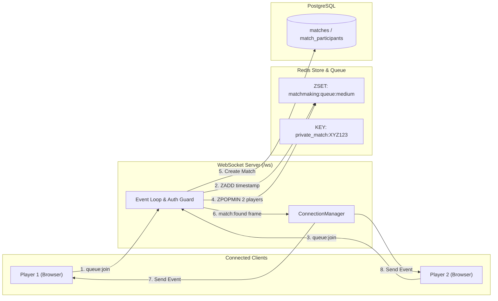

# ⚡ MeetCode - WebSockets & Real-Time Matchmaking Protocol

This document details the real-time communications architecture, Redis matchmaking queues, private match room mechanics, WebSocket event protocols, and automated forfeit handling systems implemented in MeetCode.

---

## 🛰️ Architecture Overview

Real-time interactions in MeetCode are powered by a bidirectional **WebSocket protocol** endpoint (`/ws?token=<JWT>`) built on FastAPI, managed in-memory via `ConnectionManager`, and synchronized across distributed server nodes using **Redis 7**.



---

## 1️⃣ Authentication Guard & Connection Handshake

1. **Query Parameter Token Transport**: Browsers open a WebSocket connection to `ws://localhost:8000/ws?token=<JWT_ACCESS_TOKEN>`.
2. **Handshake Verification**: `websocket_endpoint` accepts the raw connection, extracts the `token` parameter, decodes the JWT using PyJWT with `settings.SECRET_KEY`, and queries PostgreSQL to verify user existence (`get_user_from_token`).
3. **Rejection Handling**: If the token is invalid or expired, the server transmits `{"event": "auth:error", "data": {"message": "Invalid token"}}` and terminates the socket with policy violation status `WS_1008_POLICY_VIOLATION`.
4. **Registration**: Upon successful verification, the socket is registered in `ConnectionManager.active_connections[user_id]`.

---

## 2️⃣ Redis Matchmaking System (`matchmaking_service.py`)

### A. Competitive Ranked Queue (`ZSET`)
- **Redis Queue Structure**: `matchmaking:queue:{difficulty}` (e.g., `matchmaking:queue:easy`, `matchmaking:queue:medium`, `matchmaking:queue:hard`).
- **Score Assignment**: When a user joins, `add_to_queue` executes `redis.zadd(queue_key, {user_id: time.time()})`. The UNIX timestamp acts as the score to ensure strict First-In, First-Out (FIFO) ordering.
- **Match Creation Logic (`check_queue`)**:
  - Checks total queue length with `redis.zcard(queue_key)`.
  - When length $\ge 2$, executes `redis.zpopmin(queue_key, 2)` to atomically extract the two players waiting the longest.
  - If a race condition occurs and only 1 player is popped, that player is pushed back into the ZSET.
  - Upon popping 2 players, executes `_create_match(db, user1_id, user2_id, difficulty)`:
    1. Randomly selects a question of the specified difficulty from PostgreSQL (`Question.difficulty == difficulty`).
    2. Inserts a `Match` record (`mode="competitive"`, `status="active"`, `max_time=2400`).
    3. Creates 2 `MatchParticipant` records linking `user1_id` and `user2_id`.
    4. Calculates a synchronized `startTime` timestamp (current time + 5 seconds countdown offset).
    5. Sends `match:found` event frames to both players via WebSockets.

### B. Automated Matchmaking Timeout (`handle_queue_timeout`)
- When a user calls `queue:join`, an asynchronous background task (`asyncio.create_task(handle_queue_timeout(user_id, difficulty))`) is created.
- The task sleeps for **60 seconds**.
- If a 1v1 match is found before 60 seconds, the timeout task is cancelled (`task.cancel()`).
- If 60 seconds elapse without finding an opponent:
  1. The user is removed from the Redis queue.
  2. An isolated practice match (`mode="practice"`) is created in PostgreSQL with a 1-hour time limit (`max_time=3600`).
  3. Transmits a `match:practice` event frame to the user, seamlessly transitioning them to solo practice.

---

## 3️⃣ Private Match Lobby Protocol

- **Creation (`match:create_private`)**:
  1. Generates a random 6-character uppercase alphanumeric code (e.g., `AB9X2K`).
  2. Stores key in Redis: `private_match:AB9X2K` $\rightarrow$ `match_id` with a **10-minute (600s) TTL**.
  3. Creates a `Match` record in PostgreSQL with `mode="private"` and `status="waiting"`.
  4. Returns `{"event": "match:private_created", "data": {"matchId": "...", "code": "AB9X2K"}}` to the host.
- **Joining (`match:join_private`)**:
  1. The opponent submits the 6-character code via WebSocket.
  2. System checks Redis key `private_match:{code}`.
  3. If valid, attaches the joiner to the `Match`, sets `status="active"`, deletes the Redis key to block further joins, and emits `match:found` frames to both players.

---

## 4️⃣ WebSocket Event Reference Protocol

All WebSocket frames are formatted as strict JSON objects containing an `event` string and a `data` dictionary: `{"event": "<EVENT_NAME>", "data": {...}}`.

| Event Name | Direction | Payload Structure | Description |
| :--- | :--- | :--- | :--- |
| `queue:join` | Client $\rightarrow$ Server | `{"difficulty": "medium"}` | Player enters the matchmaking search queue. |
| `queue:status` | Server $\rightarrow$ Client | `{"status": "joined", "difficulty": "medium"}` | Server confirms player entry into queue. |
| `queue:leave` | Client $\rightarrow$ Server | `{"difficulty": "medium"}` | Player cancels search; removed from Redis ZSET. |
| `match:found` | Server $\rightarrow$ Client | `{"matchId": "UUID", "opponentId": "UUID", "startTime": 1700000000}` | Match created; triggers countdown and redirect. |
| `match:join` | Client $\rightarrow$ Server | `{"matchId": "UUID"}` | Player enters the editor screen for a match. |
| `match:create_private` | Client $\rightarrow$ Server | `{"difficulty": "hard"}` | Host requests creation of a private lobby. |
| `match:private_created` | Server $\rightarrow$ Client | `{"matchId": "UUID", "code": "XY71AB"}` | Host receives the private room join code. |
| `match:join_private` | Client $\rightarrow$ Server | `{"code": "XY71AB"}` | Guest attempts to join host's private room. |
| `match:completed` | Server $\rightarrow$ Client | `{"winnerId": "UUID", "reason": "submission" \| "forfeit"}` | Match ends; triggers confetti or loss banner. |
| `auth:error` | Server $\rightarrow$ Client | `{"message": "Invalid token"}` | Sent prior to closing socket on auth failure. |

---

## 5️⃣ Connection Drop & Automated Forfeit System

If a player disconnects (closes tab, loses internet, or refreshes page) during an active competitive match:

```python
except WebSocketDisconnect:
    match_id = manager.user_to_match.get(user_id)
    manager.disconnect(user_id)
    
    if match_id:
        # Check active match status in DB
        if match.status == "active" and match.mode == "competitive":
            match.status = "completed"
            match.completed_at = datetime.now(timezone.utc)
            
            # Award win to the remaining player
            for p in match.participants:
                if str(p.user_id) == user_id:
                    p.result = "lose"
                else:
                    p.result = "win"
                    match.winner_id = p.user_id
            
            # Broadcast forfeit notification to remaining client
            await manager.broadcast_match_event(
                match_id=match_id,
                event_type="match:completed",
                data={"winnerId": winner_id, "reason": "forfeit", "forfeiterId": user_id}
            )
```
This guarantees that players cannot evade loss records by abruptly disconnecting from active competitive matches.
